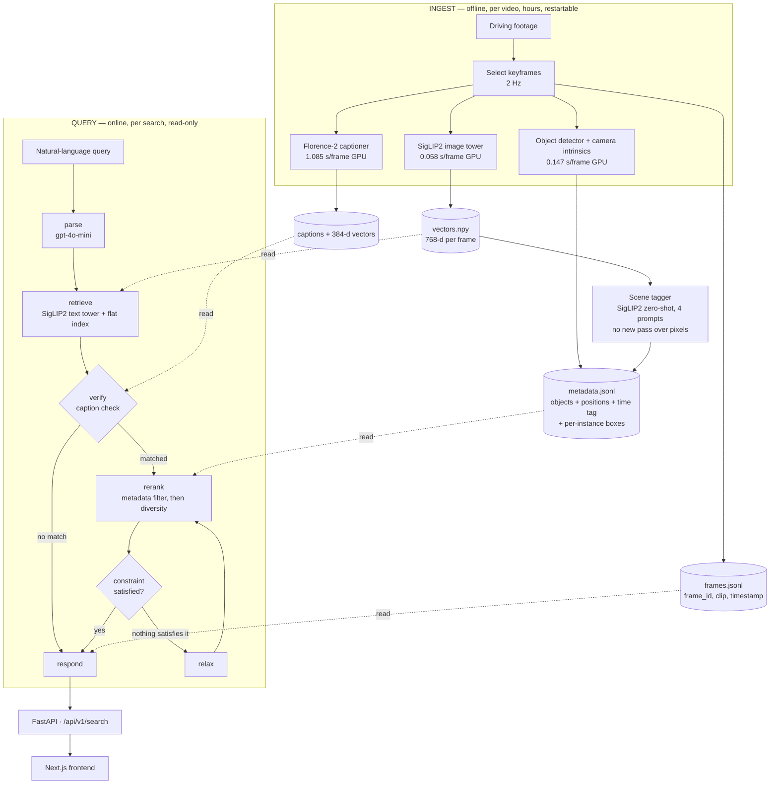
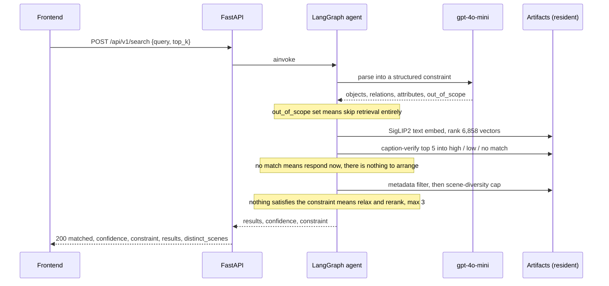

# SceneSearch — architecture

## The split that matters: *when* work happens, not *what* it does

The obvious decomposition is "a search module and a keyframe module". That splits by what the code
does, and it hides the constraint that actually governs the system. This one splits by **when the
work runs**:

**The two halves never call each other.** They share artifacts: ingest writes, query reads. That is
the answer to "how do we link them" — there is no link to design, only a contract to agree.

Consequences worth having on purpose:

- Query latency is independent of ingest. A stalled ingest job degrades freshness, never search.
- Ingest parallelises across videos without touching query code.
- Either half can be replaced. Swapping the encoder is an ingest change plus a reindex.
- **The expensive models never run inside a request.** Captioning is 83% of ingest — 1.085 s/frame on
  a Quadro P2000, and ~6.8 s/frame on the CPU serving box; both it and detection happen once,
  offline. A search runs two text towers and one matmul. The shipped 6,858-frame corpus ingested in
  **2h 20m**, ~1.2 s/frame end to end — measured with the `mobilenet_v3` detector at 0.133 s/frame.
  **The default detector is now `resnet50_v2` at 0.514 s/frame** (same card, re-measured 2026-08-25),
  so a re-ingest today costs about a third more per frame and captioning is no longer 83% of it.

## Components

| Component | Choice | Why this one |
|---|---|---|
| **Retrieval encoder** | SigLIP2 ViT-B/16 (`webli`) | Measured best of three on the selection corpus: mAP-lift **+0.277** single / **+0.271** multi, against CLIP's +0.179 / +0.167. On the shipped 6,858-frame corpus it delivers **+0.155** / **+0.073** — 17× more frames is 17× more distractors |
| **Index** | Exact flat, numpy | 6,858 vectors is one matmul: **3.99 ms/query**, 3.4% of a request. The other 97% is the text tower, which is *constant in corpus size*; approximating here would cost recall for no measurable latency |
| **Spatial filter** | COCO detector + camera intrinsics | The one thing a bigger model could not fix. "A car to the front-left" carries no object signal because cars appear in **5,187 of 6,858 frames (76%)**, so it reduces to pure position: relational lift **+0.113 → +0.388**, and q15 itself **+0.118 → +0.483**. Both figures moved on 2026-08-20 when the band was re-cut at the outer thirds of the picture; at the retired ±30° bearing band they read +0.075 → +0.290 |
| **Diversity** | Scene cap over the displayed head | At 2 Hz consecutive keyframes are near-identical. Top-10 spanned **4.13** distinct clips; a cap of 2 gives **6.75** |
| **Rejection — score** | Caption-verify the top 5, as a three-way band | **0.877** Neg-AUROC for **5 frames/query**, against **0.822** for a full caption index at 23× the ingest. On 404 frames the full index led; at scale it inverted. Band `0.30 / 0.50`, re-verified 2026-08-14 |
| **Rejection — fact** | Consult the corpus's own **census** | A caption enumerates what is *there* and never states an absence, so no cutoff can catch one — `a street at night` scored 0.559 on an all-day corpus. Refused from the **scene-tag census**, a record of what the corpus holds. A second rule refusing categories outside the detector's declared vocabulary was removed 2026-08-18 (issue #112): "the detector cannot emit this" is a fact about the *pipeline*, not the footage, and all three categories it fired on were present |
| **Query parser** | gpt-4o-mini, `temperature=0` | The only LLM call in the system: one short completion per search. Vietnamese is canonicalised to English for the rejection gate only — retrieval keeps the original, which SigLIP2 scores *better* (0.787 vs 0.750) |
| **Human review** | sqlite, pseudonymous reviewer id | The verdicts are the labelled dataset, which is why the export sits behind a login rather than being open |
| **API** | FastAPI | Async, typed request/response, generated OpenAPI docs at `/docs` |

There is deliberately **no vector database and no SQL database**. The corpus is 6,858 × 768 floats
(21 MB) and is resident in memory; Chroma or Postgres would add a service and a second copy of the
data to do the same arithmetic more slowly. `experiments/M2_DESIGN.md` §5 is where that stops being
true — at 7.2M frames, not here.

## Request path, precisely

Three orderings there are load-bearing, and each was chosen against a measurement rather than taste:

1. **Parse before retrieve** — an out-of-scope query ("a vehicle cutting into our lane") never
   reaches the pipeline. A single frame cannot show motion over time, so retrieving would produce
   ten confident, wrong frames.
2. **Verify before rerank** — the rejection band is calibrated on the *unreranked* top-5, and
   reranking deliberately reorders exactly that head. Measured during calibration on the 404-frame
   corpus: one query scored 0.431 before and 0.395 after, across what was then a 0.457 cutoff. The
   band is now **0.30 / 0.50**, re-fitted on this corpus — the ordering is what keeps the calibration
   meaningful, whatever the numbers are.
3. **Filter before diversity** — the filter promotes frames satisfying the constraint, diversity
   then spreads them across clips. Reversed, the filter undoes diversity's arrangement.

## Error handling at each layer

| Layer | Failure | Behaviour |
|---|---|---|
| API | invalid request | `422` from Pydantic validation, before any work is done |
| API | unknown thumbnail id | `404`; the id is path-traversal checked before touching disk |
| API | unexpected | `500` with a **generic** detail — the real message goes to the log, never to the client |
| Agent | any node raises | caught in-node, sets `error`, routes straight to `respond` → an honest empty answer |
| Agent | infinite loop | `MAX_ITERATIONS = 3`, and the loop also exits as soon as nothing is left to relax |
| Service | artifacts missing | startup logs and continues: `/health` stays up, `/status` returns `503` |
| Service | corpus misaligned | `Corpus.load` raises on a row-count mismatch rather than serving confident results for the wrong frames |
| Search | nothing matches | not an error — `200` with `matched: false` and a plain-English reason |

## Scale — what does not survive

At 1,000 hours and 2 Hz the corpus is 7.2M frames — a thousand times what ships. Projecting the
**CPU** rates, which is the floor a deployment without a GPU pays:

| | per frame (CPU) | at 7.2M | storage |
|---|---|---|---|
| SigLIP2 embed | 0.173 s | ~346 CPU-hours | 22 GB fp32 |
| Florence-2 caption | 4.0 s | ~8,000 CPU-hours | + 384-d text vectors |

Two consequences, both recorded as open in `experiments/M2_DESIGN.md`:

- **The flat index does not survive — but it survived this jump comfortably.** Search went 0.9 ms at
  404 frames to 3.99 ms at 6,858: 17× the corpus for 4.4× the time, sublinear because BLAS overhead
  amortises across a larger matmul. A linear extrapolation predicted ~15 ms. It still scans every
  vector per query, so ANN with measured recall loss remains the M3 item — the corpus that forces it
  is nearer 7.2M than 6,858.
- **fp16 storage is not free, and gets *worse* with scale.** Casting vectors to fp16 changes the
  top-10 for **1,926 of 6,858 probes (28%)**, against 68 of 404 (17%) on the smaller corpus, because
  the quantisation error (2.4e-04) is the same size as the median gap between adjacent scores
  (2.3e-04). More frames in a bounded embedding space means smaller gaps, so the damage grows with N
  alongside the saving. The 21 MB saved is not worth a measurable change in what the user sees.

Full reasoning and the measurements behind every number above:
[`experiments/M2_DESIGN.md`](../experiments/M2_DESIGN.md) and
[`experiments/m1/RESULTS.md`](../experiments/m1/RESULTS.md).
