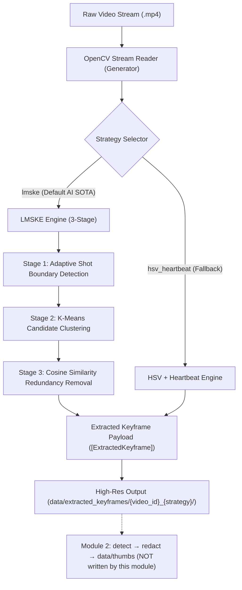

# 🚀 Module Ingestion: Adaptive Keyframe Extraction (FR-01.2)

> **AI Agent & Developer Specification Document**  
> Primary Entry Point: [`scripts/ingest/run_keyframing.py`](run_keyframing.py)  
> Core Service Engine: [`src/services/ingest/keyframing.py`](../../src/services/ingest/keyframing.py)

---

## 📌 1. ARCHITECTURE & SPECIFICATION SUMMARY

This module implements **Adaptive Keyframe Extraction (SRS FR-01.2)** for raw video streams (Full HD / 2.5K Quad HD). It eliminates **>99% redundant frame data** while preserving critical event transitions and temporal continuity.



> [!CAUTION]
> **This module writes no thumbnails.** The dotted edge is a handoff, not a step it performs — see
> §7 Invariant 4 and [`docs/handover/keyframe-handoff-contract.md`](../../docs/handover/keyframe-handoff-contract.md) §3.

### Dual-Engine Dispatch Matrix:
* **Primary AI Engine (`lmske`):** Implements Tan et al. ArXiv 2024 / VBS 2025 algorithm (Shot Boundary Detection + Candidate Clustering + Cosine Similarity Threshold $\ge 0.80$). Benchmark: F1 = `0.5311`, Compression = `99.28%`.
* **Fail-Safe Fallback Engine (`hsv_heartbeat`):** HSV color delta histogram thresholding + 5.0s max heartbeat frame interval. Dispatched automatically if LMSKE encounters missing dependencies or runtime exceptions.

---

## 💻 2. ENVIRONMENT DEPENDENCIES & CONTRACTS

### System Requirements & Invariants:
* **Python Compatibility:** Python $\ge 3.10$
* **RAM Footprint:** **~660 MB** on a 9-minute 1440x1080 clip, measured 2026-08-11.
* **Hardware:** Fully functional on Single-Core CPU (Zero CUDA GPU requirements).

> [!WARNING]
> **This used to claim `< 15 MB RAM` "at all times", and that was wrong by a factor of ~40.**
> Decoding streams, but **stage 3 does not**: `_eliminate_lmske_redundancy` holds every *accepted*
> keyframe's `image_array` at source resolution so it can compare each candidate against all of
> them. Peak memory is therefore `keyframes x width x height x 3`, which grows with clip length —
> 660 MB observed on a 9-minute clip, and a 20-minute clip would be past 1.5 GB. Plan capacity from
> that, and run clips **sequentially**: two at once doubles the peak for no throughput gain.
>
> The generator rule in §7 Invariant 1 is still right and still necessary. It bounds the *decode*
> side, which is what would otherwise be a 17 GB materialisation. It never bounded stage 3.

### Dependencies (`pyproject.toml` / `requirements.txt`):
```bash
pip install opencv-python numpy pydantic pytest ruff
```

---

## 🗂️ 3. REPOSITORY PATH MAPPING

| Component | Absolute Path | Description |
| :--- | :--- | :--- |
| **CLI Wrapper** | [`scripts/run_keyframing.py`](../run_keyframing.py) | Convenience CLI launcher delegation. |
| **CLI Executable** | [`scripts/ingest/run_keyframing.py`](run_keyframing.py) | Full CLI script with argument parser. |
| **Core Algorithms** | [`src/services/ingest/keyframing.py`](../../src/services/ingest/keyframing.py) | LMSKE 3-stage engine & Fallback dispatcher. |
| **Data Schemas** | [`src/services/ingest/models.py`](../../src/services/ingest/models.py) | `IngestConfig`, `ExtractedKeyframe`, `VideoMetadata`. |
| **Stream Reader** | [`src/services/ingest/video_loader.py`](../../src/services/ingest/video_loader.py) | Memory-safe OpenCV streaming iterator. |
| **Automated Tests** | [`tests/test_services/test_ingestion_pipeline.py`](../../tests/test_services/test_ingestion_pipeline.py) | Pytest suite covering LMSKE & Fallback. |

---

## 🤖 4. AI AGENT EXECUTION COMMANDS (CLI RECIPES)

AI Agents and developers can run the following deterministic commands:

### Recipe 1: Default LMSKE Strategy Execution
```bash
python scripts/ingest/run_keyframing.py --video data/raw_videos/busy_urban_traffic.mp4 --strategy lmske
```

### Recipe 2: Fallback HSV+Heartbeat Strategy Execution
```bash
python scripts/ingest/run_keyframing.py --video data/raw_videos/busy_urban_traffic.mp4 --strategy hsv_heartbeat
```

### Recipe 3: Customized Sensitivity & Heartbeat Interval
```bash
python scripts/ingest/run_keyframing.py --video data/raw_videos/busy_urban_traffic.mp4 --strategy lmske --threshold 0.30 --heartbeat 3.0
```

### Recipe 4: The first-release (Hanoi) corpus settings
```bash
python scripts/ingest/run_keyframing.py --video ../data/first_release/clip01_hanoi.mp4 \
    --fov 90 --sample-fps 15 --bottom-crop 0.25 --quality-gate --avoid-wiper
```

### CLI Interface Schema (`run_keyframing.py`):
```text
options:
  --video FILE            Path to raw video file (.mp4, .avi, .mkv) [Required]
  --fov FLOAT             Declared horizontal FOV in degrees [Required; <= 60 refused]
  --strategy STRATEGY     Keyframing strategy ('lmske' | 'hsv_heartbeat') [Default: 'lmske']
  --threshold FLOAT       HSV histogram delta threshold (0.1 - 1.0) [Default: 0.40]
  --heartbeat FLOAT       Max allowed seconds between keyframes [Default: 5.0]
  --sample-fps FLOAT      Decode only N frames per second of source [Default: every frame]
  --bottom-crop FLOAT     Frame fraction ignored when COMPARING frames [Default: 0.0]
  --quality-gate          Drop frames the camera could not see through [Default: off]
  --avoid-wiper           Move a blade-crossed selection to clear footage <=0.6s away [Default: off]
```

**`--sample-fps` is the cost lever.** Wall clock is dominated by decoding, and at 60 fps consecutive
frames are 16 ms apart — not distinguishable scenes. `--sample-fps 15` cuts the decode four-fold and
removes no frame the selector could have chosen. `frame_idx` and `timestamp_s` still refer to the
**source**, so the sidecar's link back into the original footage survives a change of sampling rate.

> [!CAUTION]
> Do not reach for the older `stream_video_frames(..., fps=)` to do this. That parameter overrides
> the source rate used for *timestamp arithmetic* and decimates nothing; passing `fps=15` to 60 fps
> footage decodes everything and dates every frame four times too late. `sample_fps` is the one that
> skips frames.

**`--bottom-crop` affects comparison only; saved frames are never cropped.** On dashcam footage the
car's own bonnet fills the lower frame, contributing identical mass to both histograms and flattening
every distance. Measured at **0.25** on the first-release corpus, where per-row temporal variation
steps down at y = 0.75. Its effect on selection is small (69 vs 70 keyframes on clip24) — the value
is that it also feeds `bonnet_top` into the sidecar, which is what `ingest_folder` uses to stop the
detector filing the bonnet as a `car` in the `front_left` band.

**`--quality-gate` writes `rejected.json` beside `frames.json`.** Cut points are derived per clip
from that clip's own median, never absolute — an absolute sharpness floor tuned to catch a streaming
windscreen also deletes every frame of a hazy clip and every frame of a night clip. Measured on
clip01 (rain): **1 of 60 rejected, and it is the fully black frame.**

> [!WARNING]
> **The gate does not remove wipers, and cannot.** An earlier version of this line claimed "4 of 60
> rejected, one black frame and three wiper sweeps" — true of the first cut points, not of the ones
> that shipped. `OCCLUSION_FLOOR` was widened to 0.60 to stop the gate deleting a busy intersection
> and an underpass mouth, and a blade covers 5–15% of the frame, so **no wiper can ever reach the
> floor**. Reviewed by eye, roughly half of clip01's keyframes carried a visible blade and the gate
> passed all of them. Use `--avoid-wiper`; the gate's occlusion arm is retained only to catch a
> total blackout.

**`--avoid-wiper` writes `swaps.json` beside `frames.json`.** Rather than dropping a frame the blade
crossed, it re-points the selection at the **nearest** clear frame within 0.6 s. Rejection is the
wrong shape of answer here: the same per-pixel test also fires on footbridges, overpasses and tunnel
mouths, because a car passes under a footbridge in about the time a wiper takes to sweep. Deleting
those repeats the exact regression that cost a re-run. Moving them costs a fraction of a second —
measured on clip09 (dry, no wiper at all), all 7 firings were overhead structures and every
replacement stayed the same scene, three of them framing the height-limit sign *better* than the
original. Measured on clip01 (rain): **16 of 59 moved, median shift 0.07 s, blade coverage 0.275 →
0.027.** `shift_s` in the record is what to sort by when reviewing — a swap that used the whole
window is the one worth opening.

---

## 📄 5. DATA SCHEMAS & PAYLOAD CONTRACTS

### `ExtractedKeyframe` Pydantic Object Schema:
```python
class ExtractedKeyframe(BaseModel):
    frame_id: str  # e.g., "busy_urban_traffic_f00179"
    video_id: str  # e.g., "busy_urban_traffic"
    timestamp_s: float  # Timestamp offset from start (e.g., 5.97)
    frame_idx: int  # Original 0-based frame index (e.g., 179)
    reason: str  # Selection reason ('event' | 'heartbeat')
    image_array: Any  # NumPy ndarray BGR (Height, Width, 3)
```

### Output File System Schema:
```text
data/
├── extracted_keyframes/
│   ├── {video_id}/              # Default LMSKE production output directory
│   └── {video_id}_{strategy}/   # Non-default benchmark strategy output directory (e.g., hsv_heartbeat)
        ├── {video_id}_f{frame_idx:05d}.jpg  # Original high-res keyframe image
        └── ...
```

`data/thumbs/` does **not** appear here, and that is the point. It is `settings.thumbs_dir` — the
directory the API serves to the browser — and the only writers permitted into it are
`promote_artifacts.write_thumbnails` and `scripts/anonymise.py`, both of which mosaic faces, plates
and person head bands at source resolution *before* downscaling to `THUMB_WIDTH` (640, raised off
320 in `930fd3b`). Redacted thumbnails are generated downstream, when Module 2 ingests the folder
this module produced.

---

## 🧪 6. AUTOMATED VERIFICATION & QUALITY CHECKS

AI agents or CI/CD runners MUST execute verification before committing changes:

```bash
# 1. Execute Unit Test Suite (22 assertions)
python -m pytest tests/test_services/test_ingestion_pipeline.py -v

# 2. Enforce Linter & Style Standards
python -m ruff check src/ tests/ scripts/
```

---

## 🚫 7. CRITICAL CRITERIA & AGENT INVARIANTS

> [!CAUTION]
> **CRITICAL INVARIANT 1: Memory Streaming Rule**  
> NEVER call `list(frames_stream)` or materialize raw frames into a Python list. Quad HD (2560x1440) OpenCV frames consume ~10.5 MB per matrix. Storing 1,537 frames in memory causes **17 GB OOM Crash**. ALWAYS iterate via Generator `for frame_idx, frame in stream:`.

> [!IMPORTANT]
> **CRITICAL INVARIANT 2: Strategy Output Separation**  
> Keyframe outputs MUST be stored under `data/extracted_keyframes/{video_id}_{strategy}/` to allow side-by-side comparative benchmarks without overwriting existing extractions.

> [!NOTE]
> **CRITICAL INVARIANT 3: Automated Fail-Safe Fallback**  
> High-level dispatcher `extract_adaptive_keyframes` MUST capture any unhandled exceptions during LMSKE execution and fall back to `_extract_hsv_heartbeat` with warning logs to prevent pipeline crashes during batch ingestion.

> [!CAUTION]
> **CRITICAL INVARIANT 4: Never write into `data/thumbs`**  
> This module writes full-resolution frames to `data/extracted_keyframes/` and **nothing else**. `data/thumbs` is `settings.thumbs_dir` — the directory the API serves to the browser — so any image placed there is *published*. Writing a frame there bypasses `anonymise.redact()`, which means no face or licence-plate mosaic and no anonymisation provenance.
>
> This is not hypothetical. `save_keyframe_images` used to write a 320 px copy straight into `data/thumbs`, and commit `878eafb` committed two such images; the unredacted set reached the public Hugging Face repo by exactly that route. `scripts/publish_assets.py` now refuses an uncleared thumbnail directory and **has no `--force`** — do not add one.
>
> See [`docs/handover/keyframe-handoff-contract.md`](../../docs/handover/keyframe-handoff-contract.md) §3.

> [!CAUTION]
> **CRITICAL INVARIANT 5: The output folder holds exactly what the sidecar names**
> `save_keyframe_images` deletes `*.jpg` in the output directory that the current run did not write. Do not remove that sweep, and do not assume a re-run is harmless without it.
>
> Re-extraction *used* to be idempotent by accident: the same selection produced the same filenames, so a second run overwrote them one for one. `--avoid-wiper` ended that — it moves `frame_idx`, the filename is built from the index, so every swapped frame lands under a new name and abandons the old one. The first clip re-run left **76 JPEGs on disk for 60 keyframes**.
>
> Orphans are not inert, because `ingest_folder` falls back to lexical order at a fixed `--fps` whenever it cannot read the sidecar. In that path the abandoned images ingest too — carrying invented timestamps, and carrying back the very blades the run removed.
